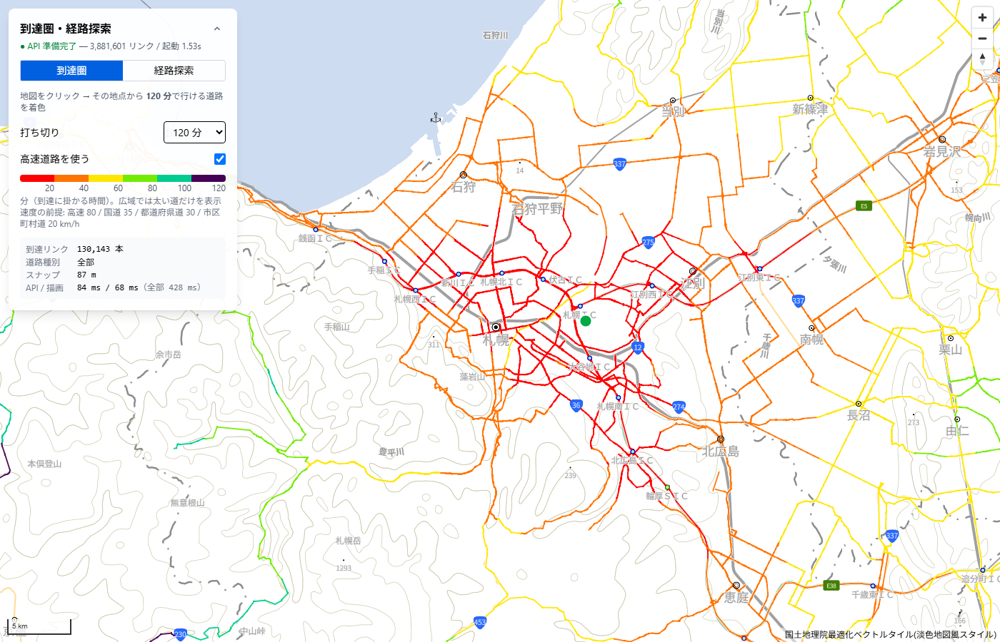

# FOSS4G 当日の予備デモと朝の確認（issue #29）

公開版（Cloudflare）が使えないとき、発表用 PC の上だけで同じ画面を動かして見せるための手順。
来場者のスマホから触ってもらうのは公開版だけで、予備は**発表者がプロジェクターで見せる**用。

| 予備の段階 | 使うもの | ネット |
|---|---|---|
| ① 公開版 | https://ksj-route-search.shi-works-worker.workers.dev | 要る |
| ② ローカルデモ（この手順） | 発表用 PC の API ＋ 画面 | 背景地図だけ要る（下の「ネットが無いとき」） |
| ③ 画面の録画 | 動画ファイル | 要らない |

## ② ローカルデモ

2026-10-07 にこの PC（Windows 11・uv 0.12・Node 22）で動くことを確かめた。Docker は要らない（DB なしで起動する。公開版と同じく、ブックマークは出ない）。

### 準備（前日まで）

git 管理外のデータが 2 つ要る。別の PC で見せるなら、この 2 つをコピーしておく。

| データ | 場所 | 大きさ | 作り方 |
|---|---|---|---|
| 組み立て済みのグラフ | `network/nationwide/KSJ_N13-24_nationwide_graph/` | 675 MB | `preprocess/build_graph_arrays.py`（parquet は無くてよい） |
| 道路タイル | `web/static/tiles/roads_nationwide.pmtiles` | 146 MB | 公開版と同じ `_v2`（`network/nationwide/roads_nationwide_v2.pmtiles` のコピー） |

```bash
uv sync
cd web && npm install
```

### 起動（ターミナル 2 つ・リポジトリのルートで）

```bash
uv run uvicorn api.main:app --port 8000      # ① API。グラフの読み込みは約 1.5 秒
cd web && npm run dev                        # ② 画面 → http://localhost:5173
```

画面左上が「API 準備完了 — 3,881,601 リンク」になれば使える。初期表示は札幌（z10・120 分）。

確かめた値（2026-10-07・この PC）:

| | 結果 |
|---|---|
| `/api/health` | `graph_loaded: true`・読み込み 1.53 秒 |
| 到達圏 札幌駅 120 分（画面） | API 84 ms・描画 68 ms・130,143 本 |
| 経路 札幌駅 → 旭川駅（高速あり） | 142 km・118 分・API 27 ms |



Docker で動かすなら `docker compose up -d`（DB も一緒に立つ・ブックマークも使える）。手順はルートの README「ローカルで動かす」。

### つまずいたところ

- **画面の `/api` が `ECONNREFUSED ::1:8000` になる**: Windows の Node は `localhost` を IPv6 で引き、127.0.0.1 で待つ uvicorn に届かない。`web/vite.config.ts` の proxy は `127.0.0.1:8000` に直してある
- **`web/e2e.mjs` は最後のブックマークで止まる**: DB なしで起動しているため（到達圏の 3 枚は撮れる）

### ネットが無いとき

背景地図（国土地理院 最適化ベクトルタイル・フォント・アイコン）は国土地理院のサーバーから読む。ネットが無いと背景は出ないが、**道路・到達圏・経路は手元のデータだけで動く**。
会場の Wi-Fi が駄目でも、スマホのテザリングで背景だけ読めればよい。

## ③ 画面の録画

撮っておくもの（いずれも札幌から始める）:

- [ ] 到達圏: 札幌駅をタップ → 120 分 → 480 分（北海道全体）
- [ ] 高速あり／なしの切り替え
- [ ] 経路: 札幌駅 → 旭川駅、札幌駅 → 函館駅
- [ ] スマホの画面（パネルの開閉・ピンチ）

## 当日の朝の確認（公開版）

1. 社内限定（Cloudflare Access）を外したかを確かめる: シークレットウィンドウで開いてログイン画面が出ないこと（外し方は `deploy/cloudflare/README.md`「社内限定の公開」）
2. 全台を起こす: `deploy/cloudflare/README.md`「当日の構成」のコマンド。全台が `"status":"ok"`
3. スマホで開き、札幌駅をタップして到達圏が出ること。経路を 1 本引くこと
4. 駄目なら②に切り替える（起動は 2 分あれば足りる）
